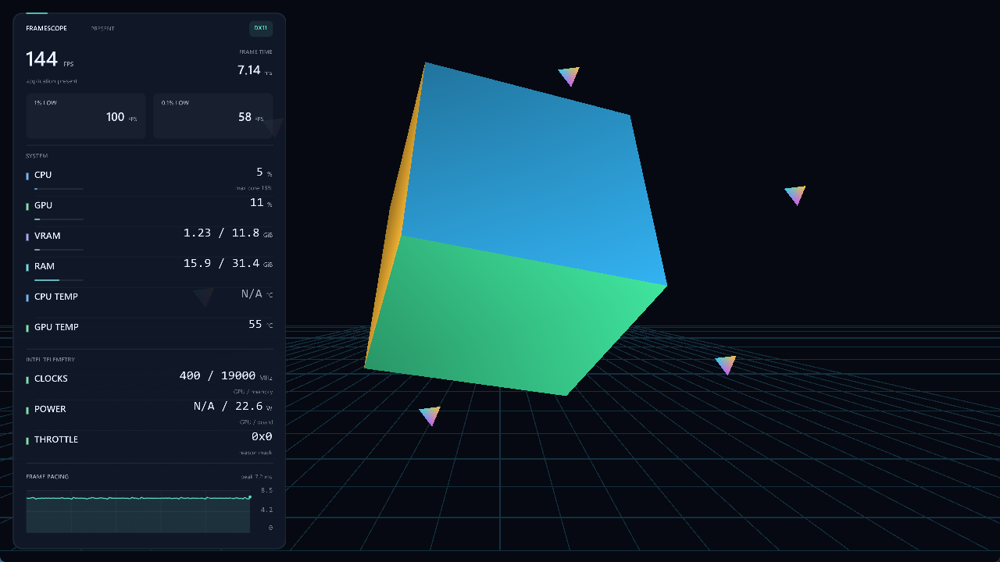

# FrameScope

**Настройте HUD. Проверьте его на настоящем рендеринге.**

FrameScope — редактор экранной статистики для **Windows 11 x64**: WPF-приложение
на .NET 10 и нативный C++ HUD для DirectX 11, DirectX 12 и Vulkan.

Это **0.1.0-preview в разработке**, не готовый универсальный оверлей для игр.
Основная цель preview — собственное приложение `FrameScope.Demo.exe` с тремя
графическими API. **CS2 исключён из области поддержки.** Совместимость с чужими
играми и античитами не заявляется.



*Реальный Debug-снимок: данные controller → native HUD, не макет интерфейса.*

## Что важно

- Редактор профилей для панели и компактной строки: системные шрифты, цветовые
  акценты, график и настройка состава показателей. Живой предпросмотр использует
  собственный Demo, а не нарисованные в редакторе «показания игры».
- FPS и frametime означают **интервалы вызовов Present**. Это не displayed FPS,
  не внутриигровой счётчик и не измерение Frame Generation.
- CPU/RAM берутся через Windows API; доступность GPU-счётчиков зависит от
  системы. Недоступные показания обозначаются **N/A**, а не нулём.
- GPU temperature читается через WDDM либо Intel Sysman с явным источником.
  Отдельный live-провайдер Intel Level Zero Sysman предоставляет поддерживаемые
  температуры GPU/VRAM, частоты, напряжение, card power и причины throttling.
  Он не настраивает частоты/мощность/вентиляторы и не подменяет отсутствующие датчики.
- Нет обязательной службы ядра, требования администратора или инструкции
  отключать защиту Windows. Vulkan layer включается только для дочернего Demo,
  без постоянной регистрации в системе.

Фактически выполненные проверки и их пределы — в
[VERIFICATION](docs/VERIFICATION.md). Наличие backend в исходниках само по себе
не доказывает его работу на конкретном GPU.

## Запуск

Планируемые форматы проверенного выпуска: **EXE-установщик** для текущего
пользователя и **portable ZIP**. Установщик не должен запрашивать UAC. В portable
пакете файл `portable.txt` рядом с `FrameScope.exe` выбирает хранение настроек
рядом с приложением; папка должна быть доступна для записи.

Запускайте `FrameScope.exe` из корня распакованного пакета. Не переносите его
отдельно: папка `native/` и остальные runtime-файлы необходимы. Самодостаточная
поставка не требует отдельной установки .NET. Для Vulkan нужен совместимый
драйвер с Vulkan runtime.

Preview не заявлен как подписанный сертификатом издателя. Windows SmartScreen
может показать предупреждение. Проверяйте источник и SHA-256; **не отключайте
SmartScreen, антивирус или другие средства защиты** ради запуска.

## Сборка из исходников

Нужны Windows x64, SDK .NET 10 из `global.json`, Python 3.10+, CMake 3.25+,
Ninja и настроенный C++ toolchain с Windows SDK. Для EXE-установщика нужен
Inno Setup 6; bootstrap может установить закреплённый 6.5.4 только для пользователя.

```powershell
powershell -NoProfile -File scripts/bootstrap.ps1
powershell -NoProfile -File scripts/verify.ps1
powershell -NoProfile -File scripts/package.ps1
```

Скрипты совместимы с Windows PowerShell 5.1 и PowerShell 7; глобальные
инструменты автоматически не устанавливают. Подробнее: [BUILDING](docs/BUILDING.md).

Для разработки есть отдельная конфигурация: `./scripts/package.ps1 -Configuration Debug`.
Она использует `artifacts/publish-debug/` и `artifacts/packages-debug/`, а имена
пакетов содержат `-debug`. Это developer preview, не benchmark Release и не
исключение из Smart App Control. О подписи без подмены доверия — [SIGNING](docs/SIGNING.md).

## Документация

- [Начало работы](docs/USER_GUIDE.md) · [Метрики](docs/METRICS.md)
- [Совместимость и границы preview](docs/COMPATIBILITY.md)
- [Архитектура и native ABI](docs/ARCHITECTURE.md)
- [Сборка](docs/BUILDING.md) · [Тестирование](docs/TESTING.md)
- [Выпуск версии](docs/RELEASING.md) · [Изменения](CHANGELOG.md)
- [Участие в разработке](CONTRIBUTING.md) · [Безопасность](SECURITY.md)
- [English](README.en.md)

## Лицензия

Copyright (C) 2026 AnoY606-git and FrameScope contributors.
Собственный код — **[GPL-3.0-only](LICENSE)**, без гарантии.
Сторонние компоненты сохраняют свои условия:
[уведомления](THIRD_PARTY_NOTICES.md), [происхождение](ATTRIBUTION.md),
[авторы](AUTHORS.md). Репозиторий: `AnoY606-git/framescope` (private).
